# walking-cat

A cat for Claude Code that walks across the band above your prompt while Claude works.



- **A progress bar with paws.** The cat sets off when a reply starts, walks at the pace of your usual replies, slows down near the end, and sprints off the moment the work is done.
- **It tells you what's going on.** A speech bubble shows the current step ("Reading register.tsx", "Searching the web: …"), and a line below shows elapsed time, steps, model, effort, and tokens.
- **It asks for attention.** When Claude is waiting on a permission prompt or a question, the cat's eyes go wide and the bubble turns to a warning.
- **Kittens for subagents.** Each subagent gets its own kitten walking as its progress bar, with its task, time, and steps.
- **A receipt when done.** After the cat leaves, a short summary stays until your next message: time, steps, tokens, files read and edited, searches, commands, and agents.
- **Ten coats**, picked at random: orange, brown, silver, and cream tabby, Russian blue, black, tuxedo, Siamese, calico, and odd-eyed white.



In the Claude desktop app the cat and kittens are animated 8-bit pixel art; in the terminal they're ASCII art.

The images above are drawn from the plugin's own sprite (`hooks/sprite.ts`).

Type `/cat` to send the cat for a stroll.

## Privacy

Everything the cat shows comes from your own Claude Code session, and nothing leaves your machine.

- **What it reads:** the tool calls Claude makes (the tool's name and a few words of its input, such as a file name, a search query, a command's description, or a web address's host), each subagent's type and task description, the model and effort level of each request, token counts, how long each reply takes, and Claude Code's notice that a permission prompt is waiting.
- **What it keeps:** the average time a reply and a subagent take, in Claude Code's own plugin storage on your machine, so the cat's pace fits how you work. Everything else lives only for the session.
- **What it doesn't do:** it makes no network requests, runs no commands, writes no files, and never changes a tool call, a prompt, or a permission. It only watches, and draws.
- **Two words that look alarming but aren't:** "tokens" in the code (`tokens()`, `contextTokens`, `outputTokens` in `hooks/cat.tsx`) means the model's token counts shown in the stats line, never a login token or any other credential. The one web address in the code, `http://www.w3.org/2000/svg` in `hooks/sprite.ts`, is the standard namespace label every SVG drawing carries; nothing is fetched from it or sent to it.

## How it works

walking-cat is a Claude Code mod: a hooks module (`hooks/register.tsx`) and the drawing code it shows (`hooks/cat.tsx`, `hooks/sprite.ts`). None of its hooks decides anything or changes anything: each one notes what happened and passes the event on exactly as it came, and the cat is drawn from those notes.

| Hook | When it runs | What it does | What it decides or changes |
| --- | --- | --- | --- |
| `session.start` | Once, as a session starts | Registers the `/cat` command | Nothing |
| `command.run` for `/cat` | When you type `/cat` | Sends the cat for a stroll and answers "Here comes the cat." | Only that command, which is its own |
| `turn.start`, `turn.complete` | As each reply (or subagent run) starts and ends | Starts and stops the cat or kitten, and records how long the reply took | Nothing |
| `turn.step` | Around each model request | Reads the model, effort level and token counts; the response streams through untouched | Nothing |
| `tool.call` | Around each tool call | Reads the tool's name and a few words of its input for the speech bubble and the summary (a file name, a search query, a command's own description, a web address's host; never a command's text) | Nothing: it never blocks, rewrites or answers a tool call |
| `classic.Notification` | When Claude Code notifies you that a permission prompt or a question is waiting | Makes the cat look alarmed until the tool call ends | Nothing: it reads the notice, and never sees or answers the prompt |
| `agent.spawn` | As a subagent starts | Reads the subagent's type and short task description for its kitten | Nothing: the subagent starts as asked |
| `ui.render` for the band above the prompt | While there's something to show | Draws the cat, the kittens and the summary in the band above your prompt; with nothing to show it leaves the band to Claude Code | While the cat is out, it draws that band itself |
| `ui.message` | When a cat or kitten has walked off | Takes it off the screen | Nothing |

## Install

At the prompt of a Claude Code terminal session:

```
/plugin install walking-cat --marketplace crswebb/walking-cat
```

Answer `y` to add the marketplace, then pick a scope (user scope loads it in every session).

From a shell:

```
claude plugin install walking-cat --marketplace crswebb/walking-cat
```

In the Claude desktop app, where `/plugin` doesn't run: click **+** next to the prompt box, then **Plugins**, **Add marketplace** with `crswebb/walking-cat`, then **Add plugin**.

## Turning it off

```
claude plugin disable walking-cat
```

## License

[MIT](LICENSE)
